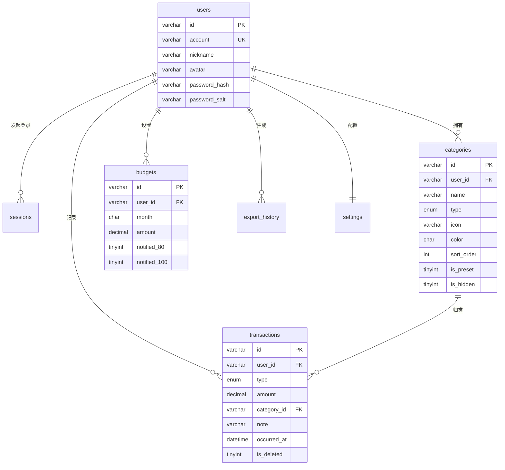

# 「随手记账」数据库设计文档

> 版本 V1.0 · 2026-10-26
> 依据：[PRD-个人消费记账产品需求文档.md](../001.产品经理PRD/PRD-个人消费记账产品需求文档.md)（第六节「数据模型设计」）
> 与前端实现 `003.前端代码/assets/js/core/{store,auth}.js`、`assets/data/seed.js`。

---

## 一、设计目标与范围

前端当前以 `localStorage` 落地两套数据（`ledger:v1` 账目、`ledger:v1:auth` 账号），
本文档将其升级为**服务端关系型数据库**，用于支撑：

1. 多账号体系（注册 / 登录 / 会话），替换「本机账号」；
2. 账目、分类、预算、导出记录、设置的结构化存储；
3. PRD V2.0 规划的云同步 / 多端一致（预留 UUID 主键与软删除）。

**本期（V1.0）表设计覆盖**：账号、会话、分类、流水、预算、导出记录、设置，共 **7 张表**。
多账本 / 家庭共享 / 同步日志等 V2.0 能力仅在本章末「未来扩展」说明，不建表。

---

## 二、技术选型

| 项 | 选择 | 说明 |
| --- | --- | --- |
| 引擎 | MySQL 8.0（InnoDB） | 多用户、事务、utf8mb4 原生支持 |
| 字符集 | `utf8mb4` / `utf8mb4_unicode_ci` | 分类图标（🍚🛍️）与头像为 emoji，必须 4 字节 |
| 主键 | `VARCHAR(36)` UUID 字符串 | 对齐 PRD 6.1「id: String(UUID)」，客户端可生成 ID，利于离线优先 + 云同步免冲突 |
| 金额 | `DECIMAL(10,2)` | 避免浮点误差；上限 99,999,999.99，覆盖 PRD FR-01 R1 的 9,999,999.99 |
| 布尔 | `TINYINT(1)` | MySQL 无原生 bool |
| 删除策略 | 流水软删除（`is_deleted`） | 对齐前端实现与 PRD FR-03 |

### 引擎与部署说明

- **有服务端 / 云同步**：直接采用本套 MySQL 方案（本仓库 `schema.sql`）。
- **纯本地（无服务端）**：PRD 6.2 提到的「本地 SQLite」可作为离线缓存，逻辑模型与本方案一致，
  类型映射：`VARCHAR`→`TEXT`、`DATETIME`→`TEXT(ISO8601)`、`JSON`→`TEXT`、`ENUM`→`TEXT + CHECK`、`DECIMAL(10,2)`→`REAL`（应用层四舍五入到分）。

---

## 三、ER 关系图

---

## 四、表结构设计

### 4.1 账号表 `users`

| 字段 | 类型 | 约束 | 说明 | 前端来源 |
| --- | --- | --- | --- | --- |
| id | VARCHAR(36) | PK | UUID 字符串 | auth `accounts[].id` |
| account | VARCHAR(20) | UNIQUE, NOT NULL | 4~20 位字母数字或 11 位手机号 | `account` |
| nickname | VARCHAR(12) | NOT NULL | 昵称 | `nickname` |
| avatar | VARCHAR(16) | NOT NULL, 默认 🙂 | 头像 emoji | `avatar` |
| password_hash | VARCHAR(255) | NOT NULL | 密码哈希 | `passwordHash` |
| password_salt | VARCHAR(64) | NOT NULL | 密码盐 | `salt` |
| last_login_at | DATETIME | NULL | 最近登录 | `lastLoginAt` |
| created_at / updated_at | DATETIME | NOT NULL | 审计字段 | `createdAt`（前端无 updated_at，新增） |

> ⚠️ 密码存储：前端当前为「随机盐 + SHA-256」演示级强度（auth.js）。
> 服务端落地后应改用 **bcrypt / argon2**（长度可容纳于 `VARCHAR(255)`）。

### 4.2 登录会话表 `sessions`

| 字段 | 类型 | 约束 | 说明 | 前端来源 |
| --- | --- | --- | --- | --- |
| id | VARCHAR(36) | PK | 会话 ID | 新增（前端单会话无 ID） |
| user_id | VARCHAR(36) | FK→users | 所属账号 | session `accountId` |
| login_at | DATETIME | NOT NULL | 登录时间 | `loginAt` |
| expires_at | DATETIME | NOT NULL | 过期时间 | `expiresAt`（30 天） |

### 4.3 分类表 `categories`

| 字段 | 类型 | 约束 | 说明 | 前端来源 |
| --- | --- | --- | --- | --- |
| id | VARCHAR(36) | PK | UUID | `categories[].id` |
| user_id | VARCHAR(36) | FK→users, NOT NULL | 所属账号 | 新增（多用户隔离） |
| name | VARCHAR(6) | NOT NULL | 分类名 ≤6 字（FR-08） | `name` |
| type | ENUM | NOT NULL | expense / income | `type` |
| icon | VARCHAR(16) | NOT NULL | 图标 | `icon` |
| color | CHAR(7) | NOT NULL | #RRGGBB | `color` |
| sort_order | INT | NOT NULL | 排序权重 | `sortOrder` |
| is_preset | TINYINT(1) | NOT NULL | 是否预设 | `isPreset` |
| is_hidden | TINYINT(1) | NOT NULL | 是否隐藏 | `isHidden` |

**约束**：`UNIQUE(user_id, type, name)` 保证同类型下不重名。

### 4.4 流水表 `transactions`

| 字段 | 类型 | 约束 | 说明 | 前端来源 |
| --- | --- | --- | --- | --- |
| id | VARCHAR(36) | PK | UUID | `transactions[].id` |
| user_id | VARCHAR(36) | FK→users | 所属账号 | 新增 |
| type | ENUM | NOT NULL | expense / income | `type` |
| amount | DECIMAL(10,2) | NOT NULL, CHECK>0 | 金额 | `amount` |
| category_id | VARCHAR(36) | FK→categories | 分类 | `categoryId` |
| note | VARCHAR(50) | NULL | 备注 ≤50 字 | `note` |
| occurred_at | DATETIME | NOT NULL | 发生时间 | `occurredAt` |
| is_deleted | TINYINT(1) | NOT NULL, 默认 0 | 软删除 | `isDeleted` |
| created_at / updated_at | DATETIME | NOT NULL | 审计 | `createdAt` / `updatedAt` |

**核心索引**：`(user_id, occurred_at)` 支撑流水列表按时间倒序与按月统计。

### 4.5 预算表 `budgets`

| 字段 | 类型 | 约束 | 说明 | 前端来源 |
| --- | --- | --- | --- | --- |
| id | VARCHAR(36) | PK | UUID | `budgets[].id` |
| user_id | VARCHAR(36) | FK→users | 所属账号 | 新增 |
| month | CHAR(7) | NOT NULL | YYYY-MM | `month` |
| amount | DECIMAL(10,2) | NOT NULL | 月度预算 | `amount` |
| notified_80 / notified_100 | TINYINT(1) | NOT NULL, 默认 0 | 阈值提醒是否已发 | `notified80` / `notified100` |

**约束**：`UNIQUE(user_id, month)`（每用户每月一条，FR-07 R1）。

### 4.6 导出记录表 `export_history`

| 字段 | 类型 | 约束 | 说明 | 前端来源 |
| --- | --- | --- | --- | --- |
| id | VARCHAR(36) | PK | UUID | `exportHistory[].id` |
| user_id | VARCHAR(36) | FK→users | 所属账号 | 新增 |
| export_range | VARCHAR(32) | NOT NULL | 范围名称（本月/近三个月…） | `range`（改名，`RANGE` 为 MySQL 保留字） |
| export_range_detail | VARCHAR(128) | NULL | 范围明细（起止日期） | `rangeDetail` |
| file_name | VARCHAR(128) | NOT NULL | 文件名 | `fileName` |
| row_count | INT | NOT NULL | 行数 | `rows`（改名，`ROWS` 为保留字） |
| file_size | VARCHAR(32) | NOT NULL | 大小展示 | `size` |
| exported_at | DATETIME | NOT NULL | 导出时间 | `exportedAt` |

### 4.7 设置表 `settings`

| 字段 | 类型 | 约束 | 说明 | 前端来源 |
| --- | --- | --- | --- | --- |
| user_id | VARCHAR(36) | PK, FK→users | 所属账号（一人一行） | 新增 |
| theme | VARCHAR(10) | NOT NULL, 默认 light | 主题偏好 | `theme` |
| reminder_enabled | TINYINT(1) | NOT NULL, 默认 1 | 提醒开关 | `reminderEnabled` |
| reminder_time | VARCHAR(5) | NOT NULL, 默认 22:00 | 提醒时间 | `reminderTime` |
| reminder_days | JSON | NOT NULL | 提醒星期数组 | `reminderDays` |
| last_category_expense | VARCHAR(36) | FK→categories, NULL | 上次支出分类 | `lastCategory.expense` |
| last_category_income | VARCHAR(36) | FK→categories, NULL | 上次收入分类 | `lastCategory.income` |
| privacy_accepted | TINYINT(1) | NOT NULL, 默认 0 | 隐私同意 | `privacyAccepted` |

> `reminder_days` 用 JSON 存储前端数组 `["1","2",…,"0"]`；如需强类型可拆
> `setting_reminder_days` 子表，本期以 JSON 简化。
> `last_category_*` 使用 `ON DELETE SET NULL`：分类被删后置空，前端回退到兜底分类。

---

## 五、关键设计决策

1. **预设分类按用户复制**：注册时为每个账号写入 19 个预设分类（`is_preset=1`），
   与前端「预设 + 自定义同列表」模型一致，天然支持「预设可改名/隐藏、不可删除」（FR-08 R1）。
2. **软删除流水**：`is_deleted` 标记，删除可追溯、便于未来「回收站」与同步冲突处理；预算/统计只算未删除流水（FR-07 R3）。
3. **金额用 DECIMAL**：避免浮点累计误差；`DECIMAL(10,2)` 上限覆盖 PRD 上限。
4. **UUID 字符串主键**：客户端生成 ID，离线记账再同步时无主键冲突，为 V2.0 云同步铺路。
5. **`settings` 与 `users` 分表**：对应前端 `ledger:v1` 与 `ledger:v1:auth` 分离——「清除全部数据」只清账目与设置、不动账号（前端 `wipeAll` 保留预设分类）。
6. **保留字规避**：前端字段 `range`/`rows` 已重命名为 `export_range`/`row_count`，`size`→`file_size`。

---

## 六、索引与查询映射

| 前端查询（store.js） | 依赖索引 |
| --- | --- |
| `listTransactions`（时间倒序 + 筛选） | `idx_user_occurred (user_id, occurred_at)` |
| `summary` / `dailyStats` / `categoryStats`（按月聚合） | `idx_user_occurred` + `idx_category` |
| `listCategories(type)`（按类型 + 排序） | `idx_user_type_sort (user_id, type, sort_order)` |
| 预算按 `(user_id, month)` 取唯一行 | `uk_user_month` |
| 登录查账号 | `uk_account` |

---

## 七、未来扩展（本期不建表）

- **V2.0 云同步 / 多账本**：引入 `ledgers`（账本）、`sync_log`（同步日志）、`devices`（设备），
  业务表增加 `ledger_id` 维度；`updated_at` + 软删除 + UUID 已为增量同步预留。
- **V1.2 账单导入**：新增 `import_history`（导入来源、文件名、去重指纹）。
- **本地 SQLite 缓存**：逻辑模型不变，见第二章类型映射。

---

## 八、脚本

| 文件 | 说明 |
| --- | --- |
| [schema.sql](schema.sql) | 建库 + 7 张表 DDL（含索引、外键、注释、CHECK 约束） |
| [seed.sql](seed.sql) | 演示账号 + 19 个预设分类参考数据 |
